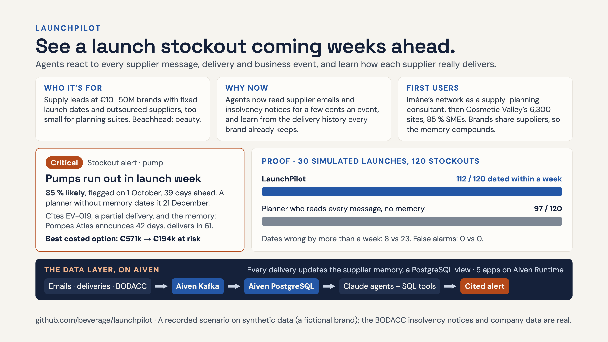

# Submission

The organisers' form has eight fields, six of them required. Answers can be changed until the deadline, so submit early and update. Drafts below are paste-ready; owners and status live on the [task board](PLAN.md#workstreams) (D1 to D5).

| Field | Required | What the form asks | Source | Board |
| --- | --- | --- | --- | --- |
| Project name | yes | Text | "LaunchPilot" | D4 |
| One-line pitch | yes | Text | Draft below | D4 |
| 3 minute demo | yes | MP4 upload: a working product solving the customer problem in one end-to-end user journey | Recorded on the deployed app after the freeze | D3 |
| The data layer in action | yes | Text: what data the agent uses, where it lives, how it flows | Draft below | D4 |
| Evidence it works | yes | Upload: a before-and-after, a benchmark, or a comparison against a no-data or naive baseline | The proof exhibit (B3) and the cost and latency panel (C3) | D5 |
| One pitch slide | yes | Link to one slide, open to anyone with the link (Google Slides). For a top-8 team this slide is the only thing shown on stage | Who, why now, first users, plus the product, the data layer and the proof | D1 |
| GitHub repo | no | Link to a public repo | https://github.com/beverage/launchpilot (front end: https://github.com/beverage/launchpilot-web) | D4 |
| Demo link | no | Link | The deployed app on Aiven Runtime | D4 |

## One-line pitch

Abstract on purpose: no named customer, and both halves of the product, reacting to business events and learning how suppliers really deliver. Pick one:

- LaunchPilot sees a launch stockout coming weeks ahead: its agents react to every supplier message, delivery and business event as it lands, and learn how each supplier really performs.
- Agents that react to every business event in a supply chain and learn from every delivery, to flag a launch stockout weeks before it happens.
- LaunchPilot reads every supply-chain event as it happens and learns how each supplier really delivers, so a launch stockout shows up weeks before it hits.

## The data layer in action

**tl;dr.** Business events → Aiven for Apache Kafka → Aiven for PostgreSQL → Claude agents with SQL-backed tools → an alert that cites its rows; every delivery updates the supplier memory, so the next forecast already knows.

- **In:** three live streams (supplier emails, goods receipts, real insolvency notices from BODACC), one Kafka topic each, bridged into PostgreSQL by an ingest app.
- **Stored:** PostgreSQL holds the planning data (orders, stock, sales, forecasts, bills of materials), the events, and everything the agents produce: alerts, scenarios, decisions, traces.
- **Used:** the agents react to each event by calling tools that query PostgreSQL (stock projection, supplier memory, open orders, costing), and every alert cites its rows.
- **Learned:** each delivery updates a SQL view of how late each supplier really delivers, and the projection draws lead times from it.
- **Runs:** five apps on Aiven Runtime; every Claude call goes through our gateway there, costed and logged.

The long version, for the form:

> LaunchPilot's agents fail without the data: with announced lead times alone, they place the launch-week pump stockout on 21 December instead of 9 November.
>
> **What the agents use.** A brand's planning data (suppliers, components, bills of materials, 78 weeks of sales by channel, forecasts, stock, 70 purchase orders with promised and actual dates) and three live streams: free-text supplier emails in French, goods receipts, and real insolvency notices from BODACC, the French official gazette, enriched with company-registry cards.
>
> **Where it lives.** Everything sits in Aiven for PostgreSQL. The streams flow through Aiven for Apache Kafka, one topic per event type (`lp.supplier_email`, `lp.po_delivered`, `lp.supplier_insolvency`); an ingest app on Aiven Runtime polls BODACC and bridges every topic into an `events` table. Five apps run on Aiven Runtime: the agent app, the ingest bridge, the HTTP API, the web front end, and a LiteLLM gateway through which every Claude call passes and is costed.
>
> **How it flows.** A worker drains due events in time order. The watch agent (Claude with tool use) reads each one and calls tools that query PostgreSQL: the stock projection, the supplier memory, open orders, scenario costing. Every alert cites the rows it rests on. A goods receipt marks its order delivered, which updates the `supplier_reliability` view: the supplier memory learns during the demo, and the next projection draws lead times from the new history. The arbitration agent costs the options in euros, and every run, tool call, token count and latency lands in `agent_runs`, which the proof tab reads live.

The data is synthetic (a fictional brand, Maison Aurore) except the BODACC notices and company cards, which are real; the app says so on screen.

## Evidence it works

Upload a screenshot of the proof tab's exhibit (B3), taken on the deployed build, plus the cost and latency panel (C3) if it fits. The numbers, from `python3 evaluate.py` (30 synthetic worlds, 120 stockouts):

| | Planner without memory (reads every message, believes announced lead times) | LaunchPilot (same reading plus supplier memory) |
| --- | --- | --- |
| Stockouts dated within one week of the truth | 92 / 120 | 118 / 120 |
| Final dates wrong by more than a week | 28 | 2 |
| False alarms | 0 | 0 |

Demo world: the pump stockout is dated 46 days ahead and raised to critical on 1 October at 91 %; the planner without memory places it on 21 December. Doing nothing puts 571 k€ of revenue at risk; the best costed option (gift set first) cuts it to 437 k€, and a rush order from the backup supplier would land on 23 November, after the gap. Say that the comparison is against an attentive planner, not a strawman spreadsheet.

## The demo video (three minutes, MP4)

One end-to-end journey on the deployed app, recorded after the freeze, once the deploy that carries A4, A6, A7 and A8 is live, the web API is rebased on main, and the order books (C7) are replayed into the stream. Press Reset first: the database is shared. Four catches, in the order the story meets them:

1. 0:00 The user and the stake: Claire, supply manager at an independent French cosmetics brand, Christmas launch on 2 November; her spreadsheet says the pumps hold until December.
2. 0:15 Reset and play. In September the retailers' order books arrive as raw numbers, not labels ("📈 Retailer orders": Sérum Éclat, 5,670 expected against 4,050 forecast over four weeks); LaunchPilot turns each into a demand change itself. (Without C7 the feed shows the recorded spikes instead; the numbers are the same.)
3. 0:40 30 September, the filler: Laboratoire Val de Loire's third capacity notice. The capacity alert says Sérum Éclat cannot be filled from launch week, 1,107 units and 54,243 € short, because the gift set is filled first; filling the overflow at Cosmétiques Normandie saves all of it. The bottles and pumps are there; the filling line is not.
4. 1:05 1 October, the pump: open the French email (Pompes Atlas confirms only 12,000 of 20,000). The pump alert turns critical: week of 9 November, 39 days ahead, 91 %; on that day the planner without memory says 28 December (21 December by the end of the replay).
5. 1:30 Propose solutions: doing nothing puts 571,097 € at risk; the best option is to fill the gift set first, 436,900 €. A rush order from Dosage Riviera would land on Monday 23 November, after the gap, so the tool shows it as worthless: the decision now is allocation, not ordering.
6. 1:55 The memory learns: show Pompes Atlas on the Supplier memory tab (60.9-day average against 42 announced, 14 late deliveries out of 14), then press Fast-forward to today. The pump receipt of 21 October lands, 79 days after the order; the average moves to 62.1 days, the planning lead time from 62 to 63, and all 15 deliveries are late.
7. 2:15 The same fast-forward brings a real BODACC notice for the gift-box supplier (label it as a demo mapping): 12,000 of the 21,000 launch boxes are still on order with it; if this order does not arrive, the gift set runs out the week of 16 November instead of 14 December, about 1.07 M€ more at risk, with no second source. Say "if this order does not arrive": the real company keeps trading under court supervision.
8. 2:35 Proof: 118 vs 92 of 120 stockouts dated within a week, 2 vs 28 dates wrong by more than a week, against the planner without memory; cost and latency per event.
9. 2:55 What is live (Claude agents, Kafka streams, BODACC) and what is recorded (synthetic data, fixed scenario).

## The pitch slide

The slide: [pitch-slide.png](pitch-slide.png), public at https://raw.githubusercontent.com/beverage/launchpilot/main/docs/pitch-slide.png. Imène to confirm the first-users line (her network, the Cosmetic Valley figures from her brief).

The form says this slide is the only thing shown on stage, so it carries the whole story: who it is for (Claire, supply manager at an independent French cosmetics brand of 10 to 50 M€, below the size planning tools target), why now, how we reach the first users, a product screenshot (the critical pump alert), the data flow in one line (streams → Kafka → PostgreSQL → agents with tools → cited alert), and the proof number. Share it as "Anyone with the link can view" and test the link from a private window.

## Before submitting

- The demo link points at a shared database: anyone who presses Reset changes what the others see. Decide whether to submit it, and when.
- Open the GitHub link logged out and check the README numbers match the proof tab.
- Test every link from a private window.
