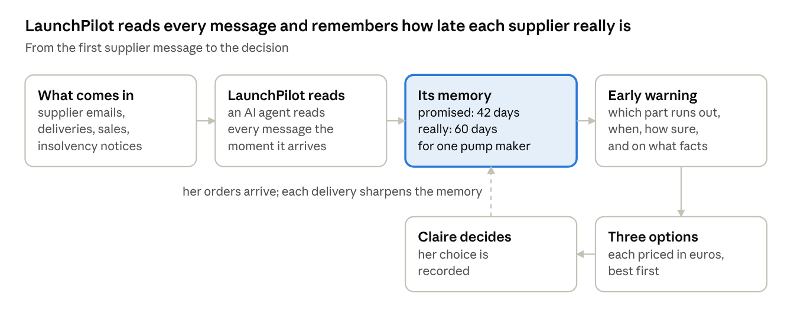
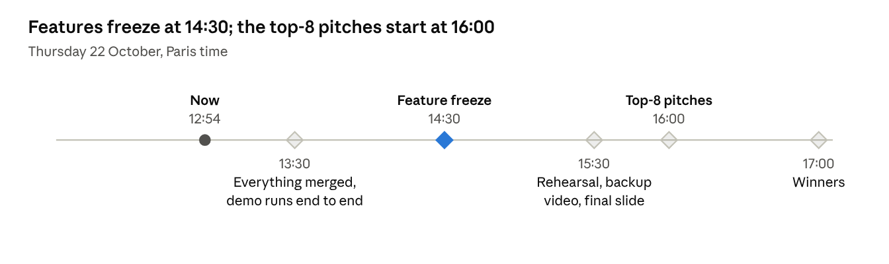

# LaunchPilot in plain words

22 October 2026 · Alex Beverage

> A snapshot from around 13:00 on the hackathon day, kept as it was. The headline numbers changed at 14:30: the final ones are in the [postmortem](postmortem.md).

LaunchPilot warns a cosmetics brand weeks ahead that a packaging part will run out before a product launch. It explains why, and prices the ways out in euros. This page skips the technical detail; the [technical design](design-technical.md) has it.

## The problem

Claire runs supply at a mid-sized French cosmetics brand and is launching a Christmas gift set. (Our demo brand, Maison Aurore, is made up.) To build it she needs bottles, pumps and boxes from outside suppliers.

- **Suppliers promise dates they don't keep.** One pump maker promises delivery in 42 days and actually takes 60.
- **Orders are hard to fix late.** Suppliers set high minimum quantities, and sales forecasts keep moving.
- **She finds out too late.** A missing part usually shows up when the production line stops, days before the launch.
- **The tools are too big for her.** Planning software exists, but it is built for companies several times her size.

## How it works

LaunchPilot does two things a busy planner cannot: it reads every supplier message as it arrives, and it remembers how late each supplier has really been.

The memory is what makes the warning early. Even a planner who reads every message still believes the dates suppliers promise. Every number LaunchPilot shows comes from a calculation the team can check; the AI decides what to look at and explains the result in plain words.

## What is real and what is simulated

The AI and one news feed are real; the brand and its data are simulated. We say this out loud during the demo.

| Part of the demo | Real or simulated |
| --- | --- |
| The AI agents that read messages and propose options | Real, running live |
| Insolvency notices of French packaging and cosmetics makers | Real, from France's official business gazette, checked every hour |
| The brand, its suppliers, products, orders and stock | Simulated |
| The season's supplier messages | Simulated, played back at speed |

One link is deliberate and labelled. For the demo, one made-up supplier, Coffrets Prestige, which makes the gift box, is linked to a real box maker that went into receivership on 8 October. A label on screen says the notice is real and the supplier is made up. The warning is only about whether supply continues, never about how late that company delivers.

## How we know it works

We hid 120 part shortages in 30 simulated launches and asked who could date them. LaunchPilot dated 112 of them to within a week. A careful planner reading every message dated 97.

| Out of 120 shortages | Careful planner, no LaunchPilot | LaunchPilot |
| --- | --- | --- |
| Dated to within a week | 97 | 112 |
| Dated more than a week off | 23 | 8 |
| False alarms | 0 | 0 |

The “careful planner” reads every supplier message the day it arrives and believes the dates suppliers promise. Hardly anyone at a small brand has time to do that. LaunchPilot does that reading for Claire, and adds what the planner lacks: a memory of how late each supplier really is.

In the demo story, LaunchPilot first warns Claire 46 days before the pumps run out, then raises the alarm 39 days ahead, 85 % sure. Doing nothing puts €571,000 of sales at risk; the best option cuts that to €194,000.

## The five-minute demo

1. **The opening line.** “Her spreadsheet says the pumps hold until December. LaunchPilot knew on 1 October they won't make launch week.”
2. **The season at speed.** We play the autumn's supplier messages quickly, up to the day a supplier delivers only part of a pump order.
3. **The warning.** The pump turns red. LaunchPilot says it will run out in launch week, how sure it is, and which facts it used.
4. **The options.** Claire asks for solutions and gets three, priced in euros, best first. She picks one, and her choice is recorded.
5. **The memory and the test.** We show each supplier's promised and real delivery times, then the test results above.
6. **A live moment, being tested now.** When the story reaches its date, a real insolvency notice arrives about the box maker linked to Claire's gift box supplier, and LaunchPilot flags the risk to the gift box.

## Where we are

At 12:54, every planned feature is built. What is left: putting the latest version online, checking the live moment, polish and rehearsal.

Done:

- Imène's prototype runs online in our shared project. Its AI agents work live, and their costs are tracked through our own AI gateway on Aiven.
- The honest test above, the app in English, LaunchPilot reading French supplier emails, and its memory learning from each delivery all went in between 11:25 and 12:16.
- Three live feeds (insolvency notices, supplier emails and deliveries) flow through Aiven's streaming service.
- The simulated data now holds together. Past orders match what was actually used, and the pump maker's minimum order is lower (Alex's call).
- A second screen, a web version built in Lovable, is online beside the original app.

Under way:

- Putting the latest version online once Imène has reviewed the English wording.
- Checking the live moment: the real insolvency notice reaching the gift box on the online app.

After the freeze, only polish happens if time allows: clearer key screens, a chart of the test results, and the cost of each AI step.

## Decisions we need

- **Who presents, and in which language.** The app is now in English.
- **Which screen we demo.** The current app, or the new web front end being built in Lovable.
- **A quote from a real planner** about promised versus real delivery times, to say on stage.
