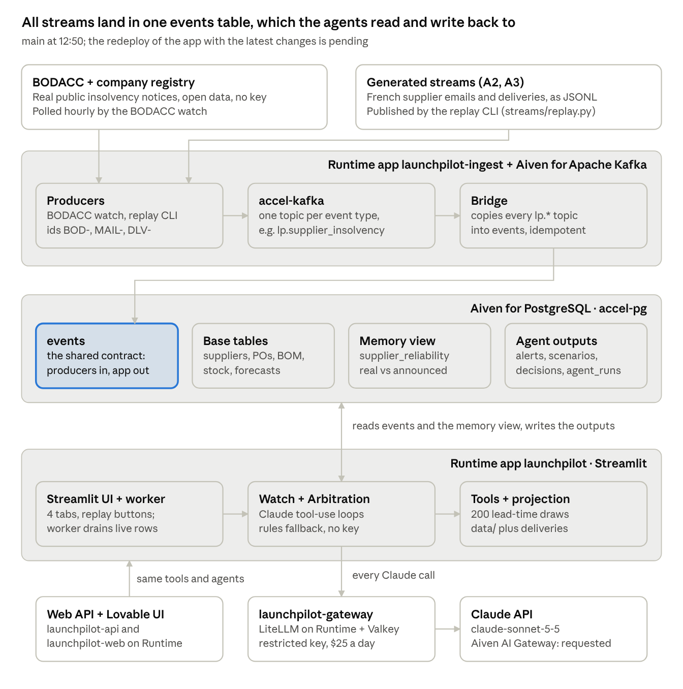
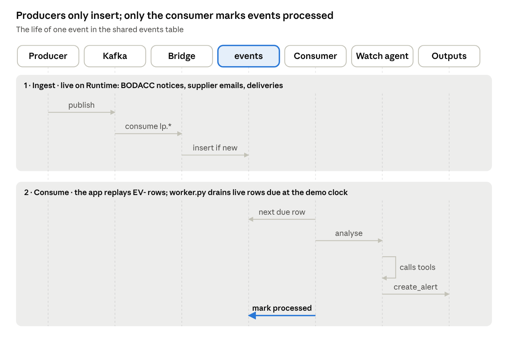
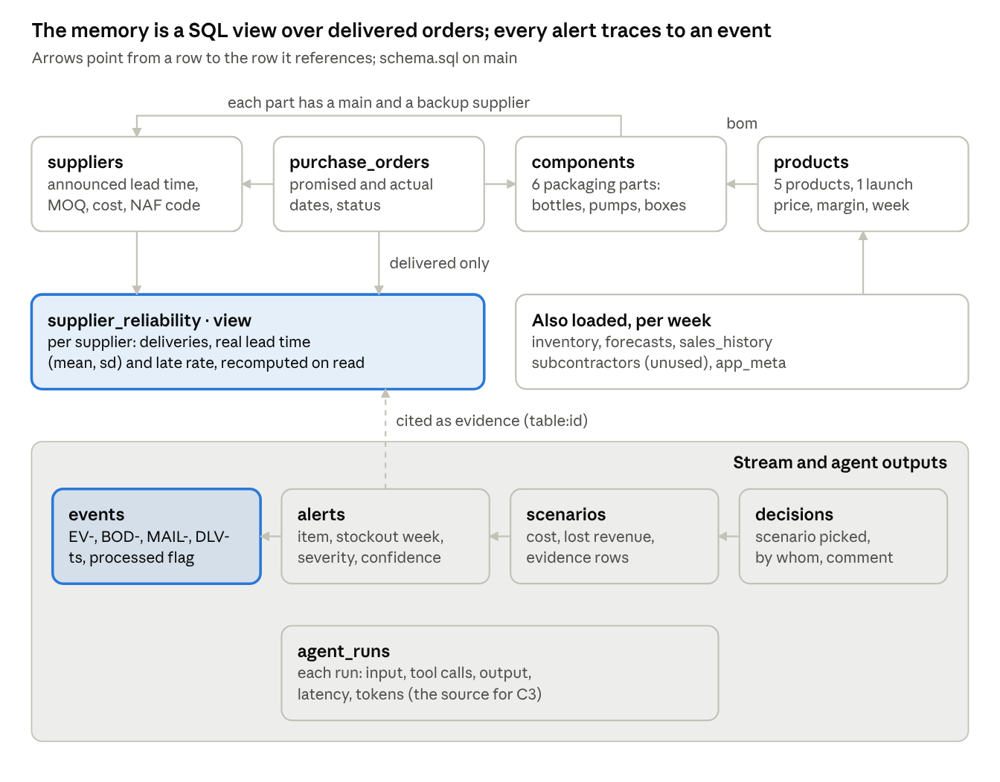
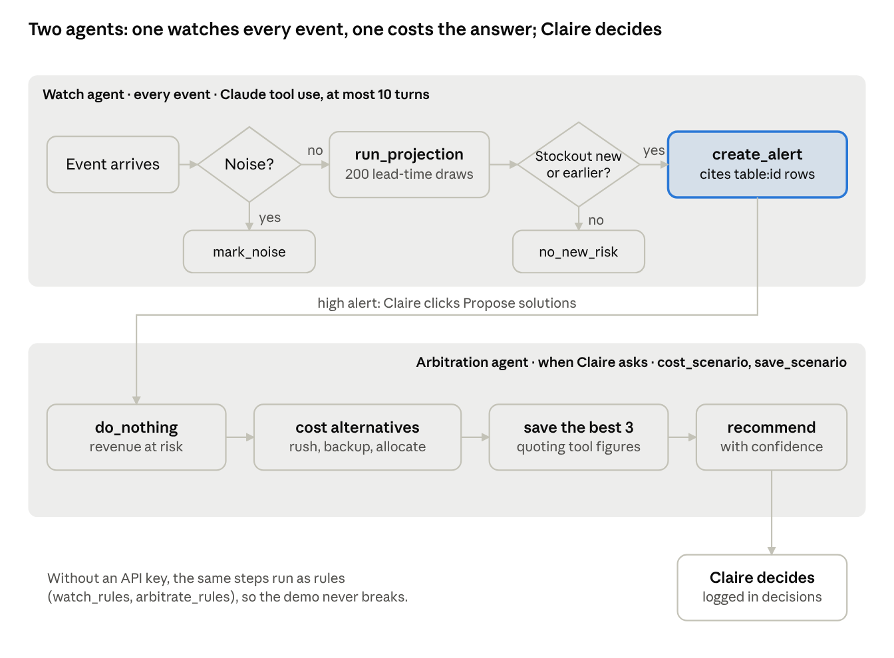
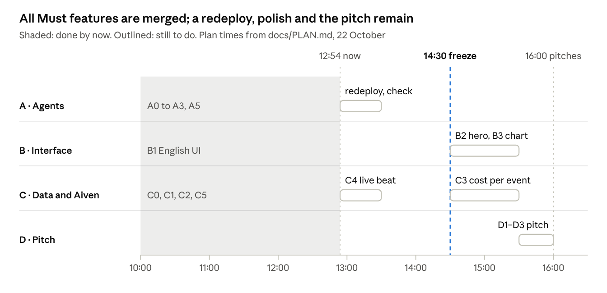

# LaunchPilot technical design

22 October 2026 · Alex Beverage

> A snapshot from around 13:00 on the hackathon day, kept as it was. The headline numbers changed at 14:30: the final ones are in the [postmortem](postmortem.md). The [plain-words version](design-in-plain-words.md) skips the technical detail.

## Status of this document

This is a snapshot of [beverage/launchpilot](https://github.com/beverage/launchpilot) at 12:50 on 22 October (first written at 11:50), taken while four Claude sessions and the team build in parallel. Anything on `main` (commit `f599116`) is settled; the deployed apps may lag it. Where this doc and the repo disagree, `DECISIONS.md` and `docs/PLAN.md` on `main` win. Times below are commit times; a few board stamps run about 20 minutes ahead of them.

- **Done on `main`:** the ported kit (A0), the Runtime deploy (C0), live Claude (A1), the fair-baseline proof (A5), supplier emails read live (A2), deliveries that teach the memory (A3), the English UI (B1), the LiteLLM gateway (C1), three live streams through Kafka (C2), and the test-data fixes with a labelled real-company mapping (C5).
- **Deployed beside it:** the web API (`launchpilot-api`, branch `web/api`) and the Lovable front end (`launchpilot-web`, its own repo).
- **Waiting:** a redeploy of the app with B1, A2, A3 and C5, held for Imène's review of the English wording; the check that a real BODACC notice reaches the agent at the right moment (C4).
- **Not started:** hero moments (B2), proof chart (B3), cost per event (C3), capacity drops (A4) and the pitch (D1 to D3).

## Problem, user and goal

LaunchPilot warns a cosmetics supply manager weeks ahead that a launch component will run out, because it learns how late each supplier really delivers and reads every supplier message as it arrives.

- **User:** Claire, supply manager at an independent French cosmetics brand with €10–50M revenue. The demo brand, Maison Aurore, is fictional, and so is its data.
- **Pain:** packaging suppliers announce lead times they don't keep (Pompes Atlas announces 42 days and delivers in 60), MOQs are high, and forecasts move. Planning tools target companies above about $50M.
- **The claim we can defend:** the fair baseline is a planner who reads and retypes every supplier email the day it arrives, which nobody at an SMB does. LaunchPilot does that reading and remembers each supplier. We never claim the spreadsheet sees nothing.
- **Headline numbers (A5, 30 seeds):** 112 of 120 stockouts dated within a week, against 97 for the planner without memory; 8 wrong dates against 23. On the demo seed, the launch-week pump stockout is first flagged 46 days ahead, then raised to critical 39 days ahead at 85 %. The best option cuts revenue at risk from 571 k€ to 194 k€.

| Judging criterion | What the demo shows | Gap left |
| --- | --- | --- |
| Customer problem and value | Claire, a launch at risk, euros at stake, a founder from supply-chain planning | First users named in the pitch (D1) |
| Agent capability | Watch agent reading free-text French supplier emails, arbitration agent, multi-step tool use, noise triage | None on `main`; the redeploy is pending |
| Data at the core | Supplier memory computed in PostgreSQL and updated by each delivery; three live streams through Kafka | The real-notice beat checked end to end (C4) |
| Evidence it works | Fair baseline over 30 seeds, probabilistic alerts | Proof chart (B3), cost and latency per event (C3) |
| Execution and pitch | Deployed on Aiven Runtime, English UI, one clean five-minute journey | Hero moments (B2), rehearsal (D2) |
| Aiven prize | Runtime (five apps), PostgreSQL view as memory, Kafka, a gateway on Runtime | Aiven AI Gateway access, still requested |

The app says on screen and out loud what runs live (the Claude agents, the BODACC stream) and what is recorded (the synthetic world and its fixed event stream).

## Architecture

LaunchPilot is five Aiven Runtime apps around one PostgreSQL database. The ingest service turns outside streams into rows of one `events` table; the Streamlit app's two Claude agents read those rows and write their findings back; a LiteLLM gateway carries every Claude call. A web API and a Lovable front end reuse the app's code for a second screen.

Kafka sits between the producers and the table, but nothing depends on it: without Kafka the producers insert into `events` directly, and without an API key the agents fall back to rules.

- **The consumer lives in the app.** `worker.py` drains live rows due at the demo clock, oldest first: before each recorded event, and on an “Analyse live events due now” button. There is no separate consumer service.
- **The engine still starts from `data/`.** The tools load the synthetic CSVs at start. Deliveries recorded in PostgreSQL are synced into them at start-up and reverted on reset, so the memory moves during the demo.
- **Fallback demo.** Imène's original deployment of the kit stays up as the backup if ours breaks.

## Event stream

Every stream, recorded or live, becomes rows of one `events` table with a fixed contract, so producers and the consumer can be built in parallel. The contract in `docs/INPUT-STREAMS.md` is the single source of truth for payload keys, id prefixes and the clock (decided 10:41).

Producers insert rows with `processed = false` and never touch them again. The consumer processes rows in `ts` order, and only those due at the demo clock, which is the latest `ts` among processed events.

- **Ids** carry a prefix per producer and derive from the source's own id, so re-polling is idempotent (`ON CONFLICT DO NOTHING`).
- **Timestamps** are ISO 8601 in Paris local time with no zone, never in the future. The recorded story runs from 7 September to 22 October 2026 with the launch on 2 November, so a live row dated today lands as the story's last beat.
- **Reset** deletes only `EV-` rows and the agent outputs; live rows survive it.

| Event type | Id prefix | Producer | What the consumer does | State at 12:50 |
| --- | --- | --- | --- | --- |
| `supplier_delay`, `sellout_spike`, `capacity_drop`, `po_confirmed`, `noise` | `EV-` | Recorded scenario, 35 events in `data/events.jsonl`, replayed by the app's own buttons | Watch agent projects and alerts; EV-019, a partial pump delivery, is the turning point | Live; `capacity_drop` is ignored by the projection (A4) |
| `supplier_insolvency` | `BOD-` | BODACC watch, hourly, through Kafka | Exposure check against the supplier master by name and SIREN | Live, 9 notices in `events`. One hits the labelled demo mapping; the end-to-end check is pending (C4) |
| `supplier_email` | `MAIL-` | Replay of 5 generated French emails, through Kafka | The agent extracts the order, date and quantity with `record_supplier_update`; a recorded twin is stored as superseded, so the news counts once | Live (A2), 5 rows |
| `po_delivered` | `DLV-` | Replay of 6 generated receipts, one partial, through Kafka | Marks the order delivered; the memory view and the projection update | Live (A3), 6 rows |
| `sellout_weekly` | `SELL-` | Replay or a shop export | Detects the deviation from forecast and scales demand | Not on the board |
| `holiday_closure` | `HOL-` | Holidays poller | Shifts arrivals that fall in a closure window | Deferred until the projection uses closures (10:41) |

## Data model

The data model is the kit's PostgreSQL schema, made idempotent in the port. It holds master data and orders from the generator, one `events` table for every stream, a view that turns delivered orders into supplier memory, and four tables of agent output.

Every alert and scenario cites the rows it rests on as `table:id` (for example `purchase_orders:PO-0042`), so any number on screen can be traced to its source.

- **Memory.** The view computes deliveries, mean and standard deviation of the real lead time, and the late rate per supplier. Since A5, the projection itself uses the median real lead time and 200 draws from delivered history; the view stays the on-screen proof of announced against real.
- **Learning live (A3, merged 12:16).** A `po_delivered` event marks its order delivered, with the actual date and quantity, in PostgreSQL and in the running engine. The view recomputes, and the projection treats the order as a fixed arrival and adds its lead time to the supplier's samples. Each supplier draws from its own random stream, so one delivery cannot flip another supplier's alert through sampling noise.
- **Supplier identity (C5, 12:30 and 12:39).** Suppliers carry a NAF activity code. One fictional supplier, Coffrets Prestige, carries the SIREN of a real cardboard-box maker in receivership, labelled as a demo mapping on the alert, in the prompt and on the memory tab.
- **Generator data.** On seed 42: 5 suppliers, 6 components, 5 products, 70 purchase orders and 35 recorded events, plus 5 emails and 6 receipts. C5 rebalanced the delivered history to match 78 weeks of use and lowered Pompes Atlas's MOQ from 20,000 to 6,000. Subcontractors and capacity drops stay unused (A4).

## Agents

Two Claude agents make the judgements, and every number they quote comes from a deterministic tool. The watch agent runs on each event and decides whether to alert; the arbitration agent runs when Claire asks and costs her options in euros.

The guard inside `create_alert` refuses duplicates: a component gets a new alert only when its stockout is new, or earlier than the one already open.

|  | Watch agent | Arbitration agent |
| --- | --- | --- |
| Runs | On every processed event: recorded rows from the replay buttons, live rows from the worker | On an alert, when Claire asks |
| Tools | `run_projection`, `get_supplier_memory`, `get_open_pos`, `create_alert`, `record_supplier_update` (what an email states about an order), `get_supplier_master` (exposure to an insolvency), `mark_noise`, `no_new_risk` | `cost_scenario` (six kinds), `get_supplier_memory`, `save_scenario` |
| Writes | An alert: median stockout week, severity, confidence (the stockout probability), two sentences citing `table:id` rows | Three scenarios, best first, then a recommendation and the question Claire must settle |
| Must not | Invent a figure, alert without evidence, repeat an alert | Invent a figure, ignore the safety margin of an order |
| Without a key | `watch_rules`: emails wait for the live agent, deliveries still update the memory, insolvency notices get a name and SIREN check | `arbitrate_rules`: costs five kinds and keeps the cheapest three |

- **Limits.** Model `claude-sonnet-5-5` (overridable with `CLAUDE_MODEL`), at most 10 turns of 1,500 tokens, tool outputs cut at 6,000 characters. Every run lands in `agent_runs` with its tool calls, latency and tokens.
- **Measured.** At kickoff a live step took 4 to 14 s and 3.5k to 14.6k tokens. Through the gateway, a two-turn watch run used 4,509 tokens in and 266 out, for $0.012 (C1).
- **Language (B1).** Prompts and tool texts are in English. Inputs that are authentically French stay French, and the agent explains them in English.

## Projection, memory and proof

The projection turns supplier memory into a probability of stockout per week. Against a planner who reads every message but believes announced lead times, it dates 112 of 120 stockouts within a week, against 97 (A5, merged 11:25).

How one projection runs (`project_prob` in `projection.py`):

1. For each open order, draw the supplier's real lead time from its delivered history, 200 times.
2. Apply every event seen so far: announced delays, partial confirmations, sell-out spikes, and goods receipts, which become fixed arrivals.
3. Roll weekly stock forward for each draw, from the BOM and the forecast, to the end of December.
4. Return, per component, the median stockout week, a p10 to p90 stock band, and the probability of a stockout by launch plus one week.
5. Suggest severity: high at 50 % or more by launch plus one week, medium when a stockout is likely before year end. The alert's confidence is that probability.

| 30 seeds, 120 true stockouts | Planner without memory | LaunchPilot |
| --- | --- | --- |
| Dated within one week | 97 | 112 |
| Final date wrong by more than a week | 23 | 8 |
| False alarms | 0 | 0 |

On the demo seed, the launch-week pump stockout is first flagged 46 days ahead as a watch alert, then raised to critical 39 days ahead at 85 %, while the planner's view says 21 December. The 30-seed numbers held through A3 and C5. Doing nothing puts 571 k€ of revenue at risk; the best option cuts it to 194 k€.

- **Why the baseline changed.** The kit compared against a spreadsheet that ignored sell-out spikes and partial deliveries. At kickoff, a planner who simply read every message dated 98 % of stockouts with no memory, and the old memory (mean plus one standard deviation) predicted them four weeks early in most seeds.
- **The retuned scenario.** The second pump order is now 30,000 units placed on 4 September with a 14-day announced delay, so the launch-week crunch comes from lead-time slippage, not under-ordering. A judge may ask whether we tuned the story to win. The answer: the gap now sits where the product claims to act, and the 30-seed sweep runs the same generator on every seed.
- **Still open.** The proof chart (B3) and cost and latency per event (C3) are not built.

## Outside streams

Three live streams run through Kafka today (C2, 12:30). The BODACC notices are real public data; the supplier emails and deliveries are generated and replayed. `events` holds 9 `BOD-`, 5 `MAIL-` and 6 `DLV-` rows, and the app says on screen what is real.

| Data | Real or synthetic | Source | State at 12:50 |
| --- | --- | --- | --- |
| Insolvency notices | Real, public | BODACC collective procedures, activity code confirmed in the company registry | Live, polled hourly |
| Supplier emails | Synthetic, in French | `generate_corpora.py`: 5 emails, 4 mirroring recorded events and 1 noise; replayed through Kafka | Live (A2) |
| Deliveries | Synthetic | `generate_corpora.py`: 6 receipts up to 22 October, one partial; replayed through Kafka | Live (A3) |
| Weekly sell-out | Synthetic | Replay or a shop export | Not on the board |
| Public holidays | Real | Nager.Date | Deferred until the projection uses closures |
| Weather | Not used | Open-Meteo | Dropped at 10:41: decorative for packaging supply |
| Suppliers, orders, stock, forecasts | Synthetic, seed 42 | `generate_data.py` | Loaded at start |

- **A category watch, plus one labelled mapping.** The watch follows the packaging and cosmetics sector and checks exposure against our supplier master. Since 12:39, one fictional supplier, Coffrets Prestige, carries the SIREN of a real cardboard-box maker in receivership since 8 October. The match is by SIREN only, the alert is about supply continuity and never lead times, and a label on the alert, in the prompt and on the memory tab says the notice is real and the supplier fictional.
- **Privacy.** Legal entities only, and the procedure field keeps only the judgment type, because the free-text complement names court-appointed people (12:33).
- **Company cards (12:51).** Each notice now carries a registry card: legal name, size, headcount band, founding date, status, town, open sites, latest revenue and result, and no named people. A `supplier_health` view joins each notice to the matched supplier, the alert it raised and the agent's verdict.

## User interface and demo journey

Two screens can carry the demo. The Streamlit app has four tabs: Launch, Supplier memory, Proof and Agent traces. The web front end, built in Lovable, mirrors those tabs over an HTTP API on the same code. Which one the jury sees is not decided yet.

| Surface | Where it lives | State at 12:50 |
| --- | --- | --- |
| Streamlit app (`app.py`) | Runtime app `launchpilot`, deployed from `main` | English UI, live emails and deliveries, and the labelled mapping are merged. The deployed app still runs an earlier build until the redeploy after Imène's review |
| Web API (`api.py`) | Runtime app `launchpilot-api`, from branch `web/api`: FastAPI over the same store, tools and agents, one agent run at a time | Deployed, endpoints listed at `/docs`. Routes: `/api/state`, `/projection/{component}`, `/events`, `/events/next`, `/fast-forward`, `/reset`, `/alerts`, `/alerts/{id}/arbitrate`, `/decisions`, `/suppliers`, `/proof`, `/runs` |
| Web front end | Runtime app `launchpilot-web`, from [beverage/launchpilot-web](https://github.com/beverage/launchpilot-web): Lovable, TanStack Start, React, shadcn/ui | Deployed and still being built in Lovable. Falls back to recorded data while `VITE_API_URL` is empty |

The five-minute journey, the same on either screen:

1. **Opening line.** “Its spreadsheet says the pumps hold until December. LaunchPilot knew on 1 October they won't make launch week.”
2. **Fast-forward.** Reset, then replay the season up to EV-019, the partial pump delivery, which also arrives as a French supplier email the agent reads live. The replay runs in rules mode; EV-019 runs on live Claude.
3. **The alert.** The pump turns red at 85 %, 39 days ahead, after a first watch alert 46 days ahead. The chart shows LaunchPilot's stock band diving below zero while the no-memory line holds until 21 December, and the alert cites its rows.
4. **The arbitration.** “Propose solutions” gives three costed scenarios: doing nothing risks 571 k€, the best option 194 k€. Claire picks one, and the decision is logged.
5. **Memory and proof.** Announced against real lead time per supplier, moving as goods receipts arrive, then the fair comparison over 30 seeds.
6. **The live beat (C4, being checked).** A real BODACC notice reaches the agent when the replay passes its date. Through the labelled mapping, it hits Coffrets Prestige, the gift box supplier.

Throughout, the presenter says what runs live (the Claude agents, the BODACC stream) and what is recorded (the synthetic world and its event stream).

## Deployment and environments

Everything runs on Alex's Aiven project: five Runtime apps, PostgreSQL, Kafka and Valkey. Every part has a fallback that keeps the demo journey alive, and Runtime builds each app straight from its public repo, with no GitHub connection (decided 10:49).

| Component | Runs as | Key settings | If it fails |
| --- | --- | --- | --- |
| App `launchpilot` (with the worker) | Runtime, `startup-50-1024`, aws-eu-central-1 | `DATABASE_URL`, `PROJECT_CA_CERT` in base64, `ANTHROPIC_BASE_URL`, `ANTHROPIC_API_KEY`, optional `CLAUDE_MODEL` | Imène's deployment of the kit, then the backup video (D3) |
| Ingest `launchpilot-ingest` | Runtime, `ingest/Dockerfile` | Kafka bootstrap and client certificates in base64; BODACC every 60 min over the last 30 days | Producers insert into `events` directly |
| Gateway `launchpilot-gateway` | Runtime, LiteLLM from Aiven's template, with a free Valkey and a `litellm` database in accel-pg | Restricted key: `claude-sonnet-5-5` only, $25 a day | Point both Anthropic variables back at Anthropic |
| Web API `launchpilot-api` | Runtime, `api.dockerfile` on branch `web/api` | Same variables as the app, plus `CORS_ORIGINS` | The Streamlit app |
| Web front end `launchpilot-web` | Runtime, from the Lovable repo's Dockerfile | `VITE_API_URL` | Recorded data in the front end, then the Streamlit app |
| `accel-pg` | Aiven for PostgreSQL | Idempotent schema; the bootstrap reloads master tables when the dataset fingerprint changes | The app falls back to an in-memory store |
| `accel-kafka` | Aiven for Apache Kafka, free plan, do-fra, client-certificate auth | One topic per event type | Direct inserts, as above |

- **Deploy.** Merge to `main`, then `scripts/runtime.py redeploy launchpilot`, a workspace script that lives outside the repo.
- **Variables.** Runtime rejects newlines in variable values, so certificates travel in base64.
- **Secrets.** Keys live only in the gitignored `.env.local` and in Runtime variables; the repo is public and holds none.
- **Health.** The ingest service reports its polls and inserts at `/health`; the app's header shows whether data and agents are live or on their fallbacks.

## Work in flight

At 12:54, every Must feature is merged: A0 to A3, A5, B1, C0 to C2 and C5 are done. What is left is a redeploy after Imène's review, the live BODACC beat (C4), polish after the 14:30 freeze, and the pitch.

If something slips, the plan now cuts A4, then C4, then B3; C2 and C1, the first and last in its cut order, are already done.

| Who | Done and doing | Where | Owns |
| --- | --- | --- | --- |
| Kickoff session, for Alex | A0 to A3, A5, B1 and C5 done; the redeploy after Imène's review next | Main checkout, short branches | App, agents, projection, generator, evaluation, `schema.sql` |
| Data streams session, for Alex | C0, C1 and C2 done; C4 producer live, with company cards and the `supplier_health` view since 12:51 | Worktree `launchpilot-streams`, branch `streams/ingest` | `streams/`, `ingest/`, the Runtime deploys |
| Test data session, for Alex | Section 8 of `docs/EVALUATION.md`, merged in PRs 1 and 2, which drove C5 | Short `docs/` branches, merged | Generator review |
| Frontend session, for Alex | Web API and Lovable front end, both deployed | Repo `launchpilot-web`; worktree `launchpilot-api`, branch `web/api` | `api.py`, the Lovable app |
| Imène | Pitch (D1 to D3); review of the English glossary and of section 8 | Outside the repo | Domain logic and the pitch |

Risks and open decisions:

- **The deployed app lags `main`.** B1, A2, A3 and C5 wait for a redeploy after Imène's review, and the journey must be checked again on the deployed app before the 14:30 freeze.
- **The live beat is unverified (C4).** The worker hands notices to the agent when the replay passes their date, but nobody has yet watched the mapped notice hit the gift box on the deployed app.
- **Which screen the jury sees.** Streamlit or the Lovable front end: both are deployed, and no decision is logged.
- **The plan's open-decisions list is stale.** It still lists the SIREN mapping (decided 12:39), the two new streams (12:03) and the UI language (11:32). Only the presenter and a planner's quote remain open.
- **Board stamps run ahead.** Some status times on the board are about 20 minutes later than the commits that did the work; trust the commit times.
