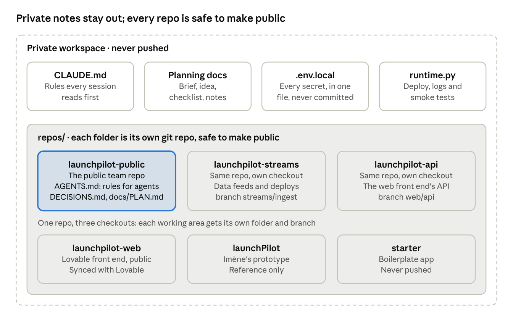

# How I piloted Claude Code at the hackathon

23 October 2026 · Alex Beverage

## In short

I treated Claude Code as a team of engineers to direct, not a chat window to type code into. Five habits did most of the work:

1. **Prepare the platform, not the product.** Three days of idea-agnostic setup meant our app was live on the required host at 10:47, under two hours after kickoff, even though we built someone else's idea.
2. **One session per area of the code.** Up to four Claude Code sessions ran at once, each owning its own folders, so they never edited the same file.
3. **One rulebook, in the repo.** A short `AGENTS.md` told every session to log each decision with its reason, claim tasks on one board, and never break the demo on `main`.
4. **I make the calls; the sessions build, test and propose.** I logged about half of the day's 50 decisions; the sessions logged a third, and asked me for the rest.
5. **Check against the live system, not the report.** Most of what went wrong happened where I trusted a summary instead of looking.

## What I brought

This method sits on experience I tend to take for granted, so here it is plainly:

- **An engineering background.** I can read a diff, spot a fragile shortcut, and tell a fair test from a flattering one. That is what let me catch the strawman comparison at 10:55 and send it back.
- **A year of building Levelang with Claude Code.** Long enough to know where sessions drift, what to write down for them, and when to stop one and start a fresh one.
- **Building game environments,** where many moving parts have to run together at every build. That habit became our one hard rule: the demo runs at every commit.
- **Two earlier one-day hackathons this autumn** (26 September and 15 October). The decision log and the agents' rulebook were refined there before LaunchPilot used them.

Without that background the structure below still works: the rulebook, the log and the board cost little and catch a lot. Expect to need smaller scope and more checking, because the hardest part of piloting is noticing when an answer sounds right and isn't.

## Before the day

I spent the three days before the event (19 to 21 October) on setup that would work for any idea, and none on product code. That paid off: I came with my own idea, joined Imène's instead, and the preparation still carried the morning.

| What I prepared | Done when | How it paid off |
| --- | --- | --- |
| A close reading of the brief, written down: the agent must fail without its data, deploying on Aiven is required, design and first users are judged | Kept in a one-page brief | Gave every session the same yardstick, and is why the flattering comparison was caught at 10:55 |
| My own idea, a supplier watchdog for payment runs, plus five questions for judging other teams' ideas | A pitch skeleton and a filter that fit on one page | I could say yes to LaunchPilot quickly, and the watchdog's data sources (French insolvency notices and company records) became LaunchPilot's real-data feed |
| Accounts on the required platform: a database, credits claimed, and Aiven's tools connected to Claude Code | Claude Code ran a real query on our database | Sessions could inspect live data from the first minute |
| A starter app (health check, database check, a Claude call) and a deploy script for Aiven's hosting | The full round trip passed locally against the real database | The app was live at 10:47, and the same script handled its redeploys all day |
| Platform notes: every command, quirk and trap found while setting up | One file, with a deploy runbook at the top | Sessions read the notes instead of rediscovering traps, and added new ones as they hit them |
| One secrets file for the whole workspace, linked into each repo and never committed | Every repo reads keys from it | No key reached a public repo all day |
| A phone-friendly arrival checklist: credits in order, questions for the hosts, the deploy steps | Readable on a phone at 08:00 | Kept logins out of the first hour, which belonged to forming the team |

Two rules held until kickoff: no product code, and a model policy, a mid-tier model by default with the strongest model at full effort only for the build decision. At 01:00 on the day, the one critical step still untested was the first live deploy. Next time I would prove it the night before.

## The workspace

One folder held everything, split so that nothing private could leak into a public repo by accident.

There are two rulebooks. `CLAUDE.md` at the root covers the workspace and every session started in it: what to read first, where the public line runs, never print a key. [`AGENTS.md`](../AGENTS.md) in the team repo covers every agent that touches the code, ours or a teammate's. I started every session from the root, partly because Aiven's tools for Claude Code were set up for that folder only.

## Running the sessions

I ran four long-lived sessions, one per area of the work, and about ten short ones for single errands. The long ones kept their context for the whole day; the short ones kept it clean.

| Session | What it owned | What it produced |
| --- | --- | --- |
| Kickoff (the app) | The agents, the forecasting engine, the data generator, the proof | The fair comparison, live email reading, the cost panel, the date fix |
| Prep (data streams) | Data coming in and every deploy on Aiven | The Kafka pipeline, the court-notice watch, company records, the AI gateway |
| Test data | Making the made-up brand hold together | Rebalanced purchase history, retailer order books, the pitch script |
| Front end | The API between Lovable and the live data | Live data in the Lovable preview, the supplier-health screen |

The short sessions each took one question, and their titles say which: "Agent traces fetch failure", "Critical alert messaging", "Event feed expandable rows", "Submission requirements". That kept a bug's detours out of the long sessions' context.

### The rulebook every session followed

The whole of [`AGENTS.md`](../AGENTS.md) fits on one screen. Its rules:

1. **Read the plan and the decision log before any task.** If a request conflicts with a logged decision, ask the human; never quietly undo one.
2. **The demo runs at every commit on `main`.** Break things on a short branch and merge only when the full demo journey still runs.
3. **Log every call as one line:** time, decision, why, who, with a small script (`scripts/decide`). No why, no line: ask for it. A reversal is a new line naming the time of the one it replaces.
4. **Claim a task on the board before starting it,** in its own small commit on `main`, so every other session sees it at once.
5. **Before handing back,** every call is logged, the board tells the truth, and nothing is left uncommitted without saying why.

### How I briefed them

- **Every task had a "done when".** "Proof tab shows the fair comparison; README numbers replaced" can be checked; "improve the proof" cannot.
- **Priorities and a cut order up front.** Must, Should or Nice on every task, and a written list of what to cut first if time ran short.
- **One contract between sessions working in parallel.** The prep session wrote the data feeds and the kickoff session read them, both working from one page of field names that the log names as the single source of truth.
- **A reason with every decision I made,** so a session that later wondered why could find it in the log instead of reopening it.

### How I checked them

- **Against the live system, read-only.** I checked results with database queries and API reads, not by clicking. After one session's button press landed in the middle of my own demo run, pressing demo buttons became off limits.
- **The board against reality.** At 13:53 I had the board's deploy notes corrected after checking what was actually live.
- **Lessons into memory.** Sessions saved traps to Claude Code's memory as they hit them, such as a hosting redeploy that reported success and built nothing, so the next session started knowing them.

## Who decided what

I owned what and why; the sessions owned how, and wrote their how down whenever it was a choice someone could undo. Of the 50 lines logged during the day, I made about half, the sessions about a third, and the rest were shared or came from Imène's review.

| Kind of call | Who | Example from the log |
| --- | --- | --- |
| Order of work | Me | 10:55: fix the flattering proof before building anything on top of it |
| What the demo shows | Me | 12:39: use a real court notice, mapped to a fictional supplier with a label everywhere |
| Honesty over a better number | Me | 14:30: fix the delivery-date bug and accept 437 k€ at risk instead of 194 k€ |
| Cuts | Me | 14:35: drop the holiday feed; 15:03: drop the capacity catch, because we had set its numbers to make it happen |
| Spend and dependencies | Me | 11:34: route every Claude call through our own gateway, with a key capped at $25 a day |
| Technical design | Sessions | 11:05: plan with each supplier's median real lead time, 200 random draws, alert at 50% |
| Guarding the demo | Sessions | 12:58: only the main app may load data, after the API reset the demo twice |
| Privacy | Sessions | 12:33 and 12:51: no named people from court notices or company records |
| Workarounds | Sessions | 10:49: encode certificates on one line, because the host rejects line breaks in settings |
| What only an expert knows | Imène | 13:27: realistic order sizes, seasonal gift sets, the French in a supplier email |

Every line carries its reason and its author, so a teammate, a judge or a new session can check any call without asking who made it or why. The full log is [`DECISIONS.md`](../DECISIONS.md).

## Where we tripped up

Every stumble below was a piloting problem, not a coding one: work that was right in one session and stale, shared or unchecked in another.

| What happened | What it cost | What I would do next time |
| --- | --- | --- |
| The kickoff session changed the headline numbers at 14:30; the slide image committed at 14:51 still had the old ones | Until 16:54 the slide we submitted showed numbers we had already replaced | One file holds the numbers, every slide and document reads from it, and a number change triggers a board task listing everything to refresh |
| Every session and both front ends shared one database | A newly started API reset the demo twice around lunch, and a session's click landed in my own demo run | A database per working area; sessions only read the demo database |
| Outputs multiplied: two decks, a design doc frozen at 13:00, submission drafts in a fourth place | Stale versions sat beside current ones, and I had to find out which was which after the event | One owner per output, and superseded versions archived the moment they are replaced |
| I reopened the freeze after 14:00 to add more catches to the demo | Building ran past the planned 15:00 freeze, and one of the new catches was cut again at 15:03 | Reopening the freeze is a logged decision that names an equal cut |
| Sessions described replayed data as "live" | Early drafts of the slides and the postmortem overstated what was live; three of four feeds were replayed from generated files | Every claim labelled live, replayed or made up, and checked before it reaches a slide |
| I read the submission form at 13:40 | The required video and the one-slide rule reshaped the afternoon | Hand the form to a session at kickoff and draft against it from the start |
| Two front ends sat on one engine | The API session had to follow the engine repeatedly, and which screen to demo stayed open all day | Pick one screen at kickoff; a second one is a cut candidate |

The common thread: Claude Code sessions are reliable within their own context and blind outside it. The pilot's job is the seams between them, and the seams got less of my attention once the afternoon got busy.

## A checklist to copy

Tick these off for your own hackathon; each one comes from something above.

### Before the day

- [ ] Write down your reading of the brief: what wins, what is required, what is judged
- [ ] Set up accounts on every required platform, with a "done when" that proves each one works
- [ ] Build a starter app and a deploy script, and prove one live deploy end to end
- [ ] Keep one private workspace for notes and secrets, with repos inside it that are safe to publish
- [ ] Put every secret in one file that no repo commits
- [ ] Write a short rulebook for the workspace and another for agents in the repo
- [ ] Write no product code before kickoff

### At kickoff

- [ ] Read the submission form and judging criteria before planning
- [ ] Split the work into areas with clear folder ownership, one session per area
- [ ] Start a decision log (time, decision, why, who) and a task board with "done when", priority, owner and a cut order
- [ ] Pick one screen for the demo
- [ ] Give each working area its own database; the demo database is read-only to sessions

### During the day

- [ ] Keep the demo running at every commit on `main`
- [ ] Open a short session for each one-off question; keep the long sessions for their areas
- [ ] Check results against the live system, read-only, before believing a report
- [ ] When a number changes, list every slide and document that quotes it, and refresh them
- [ ] Label every claim live, replayed or made up
- [ ] Treat the freeze as a decision: reopening it names an equal cut

### Before submitting

- [ ] Regenerate every slide and document from the final numbers
- [ ] Archive superseded decks and drafts
- [ ] Open every link in a private window
