# LaunchPilot pitch deck

The deck prepared for the top-8 final on 22 October 2026: ten slides that follow the three-minute script, plus the one-page slide we submitted as an appendix. Each slide is shown as an image with its speaker notes.

## 1. See a launch stockout coming weeks ahead.

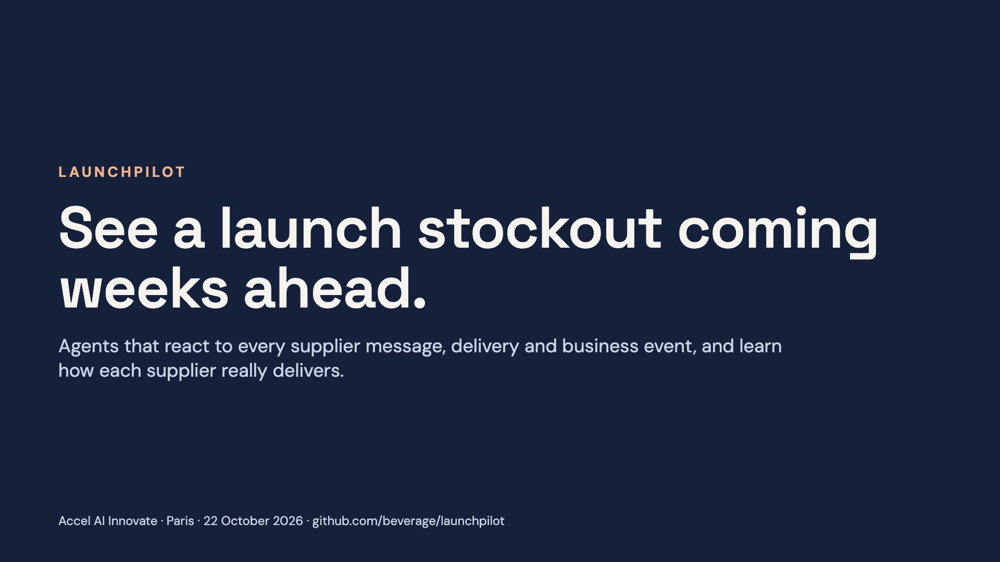

**Speaker notes**

> LaunchPilot sees a product-launch stockout weeks before it happens. Its agents react to every supplier message, delivery and business event as it lands, and they learn how each supplier really delivers. Built today on Aiven, with Claude.

## 2. Suppliers promise six weeks. They take eight or nine.

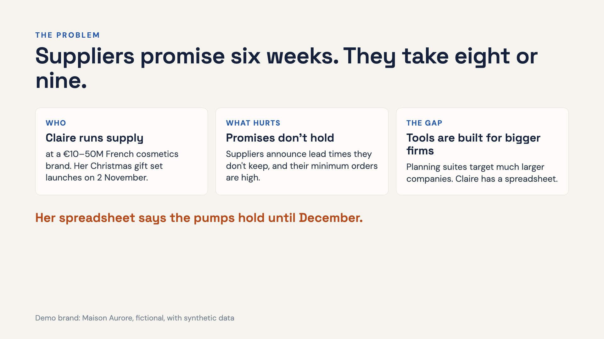

**Speaker notes**

> Claire runs supply at Maison Aurore, an independent French cosmetics brand. Her Christmas gift set launches on 2 November. Her suppliers announce six weeks and deliver in eight or nine, their minimum orders are high, and planning tools are built for much larger companies. Her spreadsheet says the pumps hold until December.

## 3. It sees the pump stockout 39 days out.

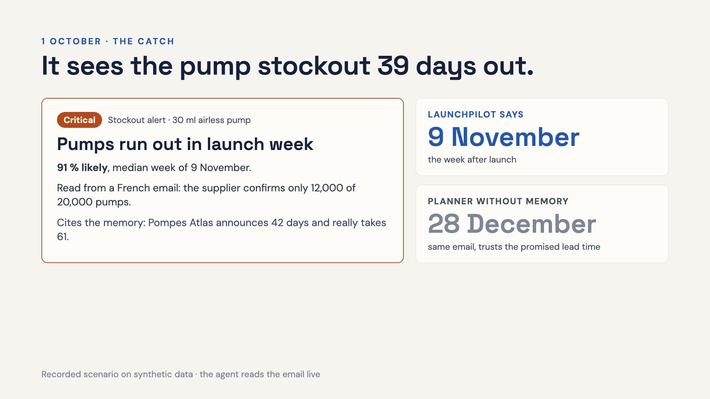

**Speaker notes**

> 1 October: an email in French. The pump supplier will deliver only 12,000 of 20,000. LaunchPilot reads it, and because it remembers that this supplier has been late on every delivery, it says the pumps run out in the week of 9 November, the week after launch, at 91 percent. A planner who reads the same email but trusts the announced lead times still sees it on 28 December. Before that, in September, the retailers' order books had already put the pumps on watch, 46 days ahead.

## 4. It prices every option in euros.

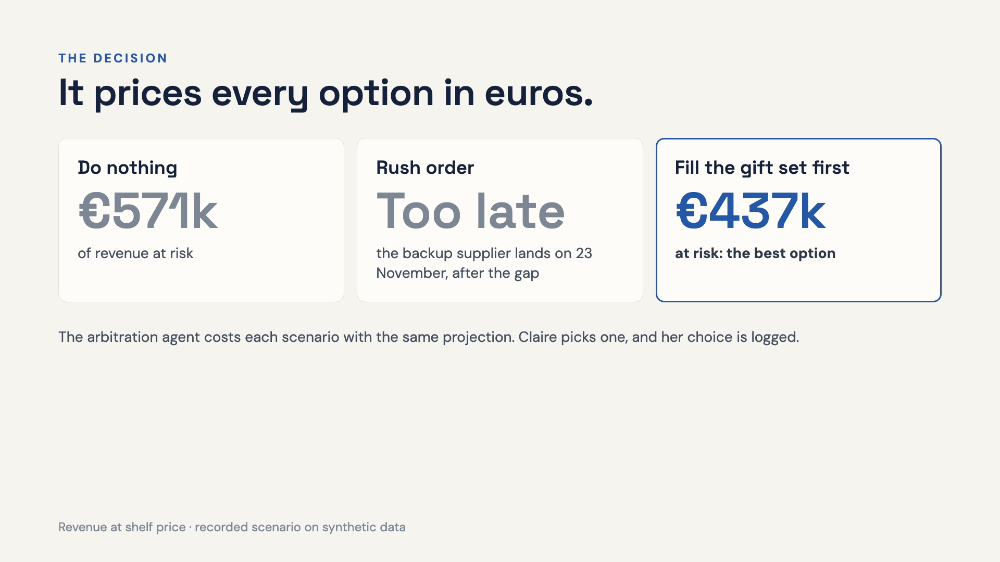

**Speaker notes**

> Doing nothing puts 571,000 euros at risk. A rush order from the backup supplier would land on 23 November, after the gap, so LaunchPilot says so. The best move is allocation: fill the gift set first, 437,000 euros at risk.

## 5. Every delivery teaches it.

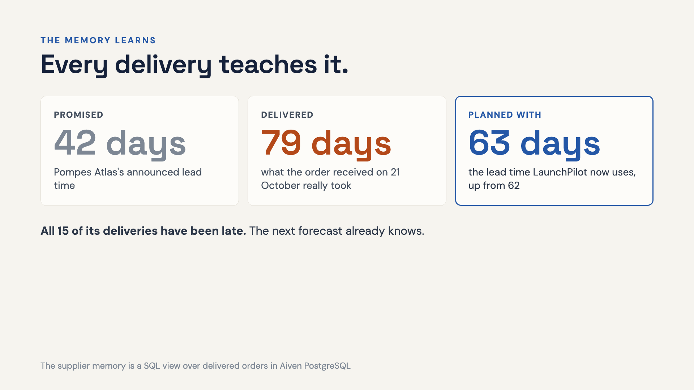

**Speaker notes**

> Every delivery teaches it. Pompes Atlas promised six weeks; the order received on 21 October took 79 days. The goods receipt arrives as an event, the supplier memory updates, and the planning lead time moves from 62 to 63 days. All fifteen of its deliveries have been late. This is the answer to "why an agent and not a rules engine": it improves from every delivery.

## 6. Signals from outside, sized in euros.

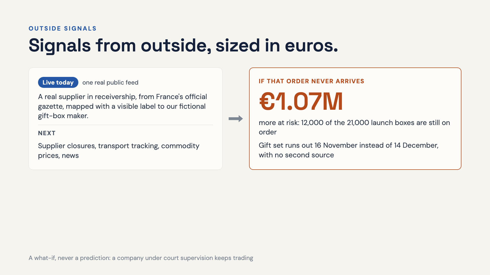

**Speaker notes**

> LaunchPilot also reads signals from outside the brand. Today one is live: real insolvency notices from France's official gazette. Next come supplier closures, transport tracking, commodity prices and news; each one lands as an event and the same agent sizes it in euros.
> This notice is real: a cardboard-box maker, in receivership since 8 October. For the demo we mapped it to our fictional gift-box supplier, and the screen says so. 12,000 of the 21,000 launch boxes are still on order with them. If that order does not arrive, the gift set runs out on 16 November instead of 14 December, about a million euros more at risk, with no second source. Say "if this order does not arrive": the real company keeps trading under court supervision.

## 7. Memory beats an attentive planner.

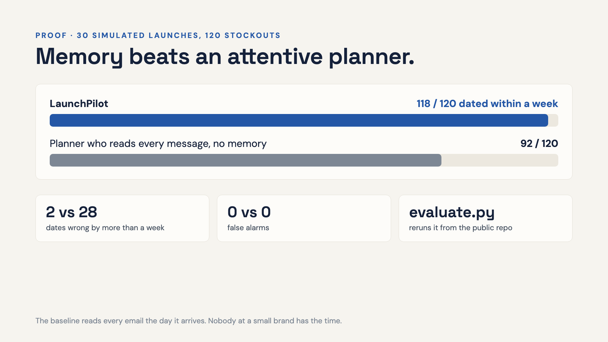

**Speaker notes**

> Over thirty synthetic worlds, LaunchPilot dates 118 of 120 stockouts within a week. The attentive planner without memory dates 92. Two dates wrong by more than a week, against 28. No false alarms on either side.
> Is the baseline a strawman? No: it reads every email and confirmation the day it arrives, which nobody at a small brand has time to do. The only thing it lacks is the supplier memory. Anyone can rerun this from the public repo with python3 evaluate.py.

## 8. Claude decides. The data does the maths.

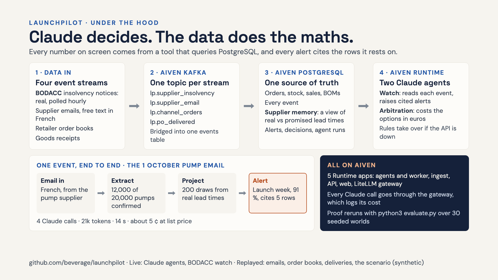

**Speaker notes**

> Read it left to right.
> Data in: four event streams. The BODACC insolvency notices are real public data, polled every hour. The supplier emails, retailer order books and goods receipts are generated for our fictional brand and replayed; we say so.
> Kafka: one topic per stream on Aiven for Apache Kafka. A small ingest app on Runtime runs the BODACC poller and bridges every topic into a single events table.
> PostgreSQL: the brand's planning data, every event, and the supplier memory, a SQL view of how late each supplier really delivers, updated by every goods receipt. Alerts, Claire's decisions and every agent run, with tokens and latency, live there too.
> Agents: the watch agent reads each event as the demo clock reaches it. Claude decides what to check; the numbers come from deterministic tools: the stock projection draws 200 lead times from the supplier's real history. The arbitration agent costs the options in euros. If the API is down, rules take over and the screen says so.
> The example: the 1 October pump email, in French. Claude extracted a partial delivery, 12,000 of 20,000; ran the projection; and raised a critical alert for launch week at 91 %, citing five rows. Four calls to Claude, about 21,000 tokens, 14 seconds, about 5 cents at list price.
> Everything runs on Aiven: five Runtime apps, Kafka, PostgreSQL and Valkey for the gateway. Every Claude call goes through our LiteLLM gateway, which logs its cost. The proof reruns from the public repo with python3 evaluate.py.

## 9. The memory compounds across brands.

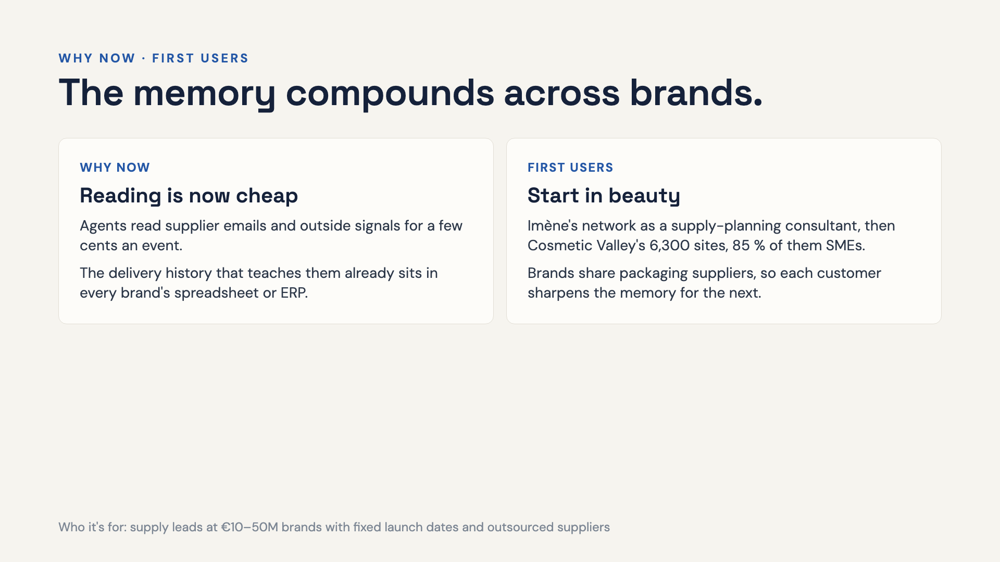

**Speaker notes**

> Why now: agents can read supplier emails and outside signals, such as official insolvency notices, for a few cents an event, and the delivery history that teaches them already sits in every brand's spreadsheet or ERP.
> First users: Imène's network as a supply-planning consultant, then the Cosmetic Valley cluster. Brands share packaging suppliers, so the memory gets better with every customer.

## 10. Live: the Claude agents and a real public feed.

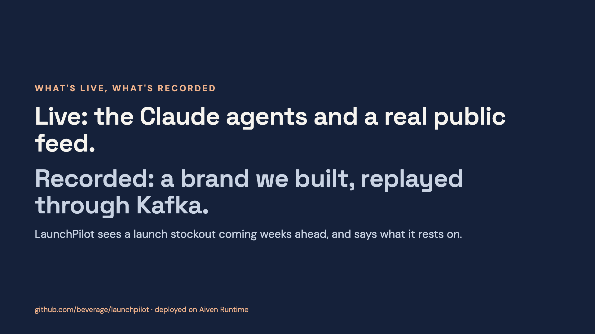

**Speaker notes**

> Live: the Claude agents and a real public feed, insolvency notices polled from BODACC every hour. Recorded: the brand and its history, which we built ourselves; its emails, order books and deliveries are replayed through Kafka. Everything is in the public repo, and the proof reruns from it. Thank you.

## 11. Appendix: See a launch stockout coming weeks ahead.

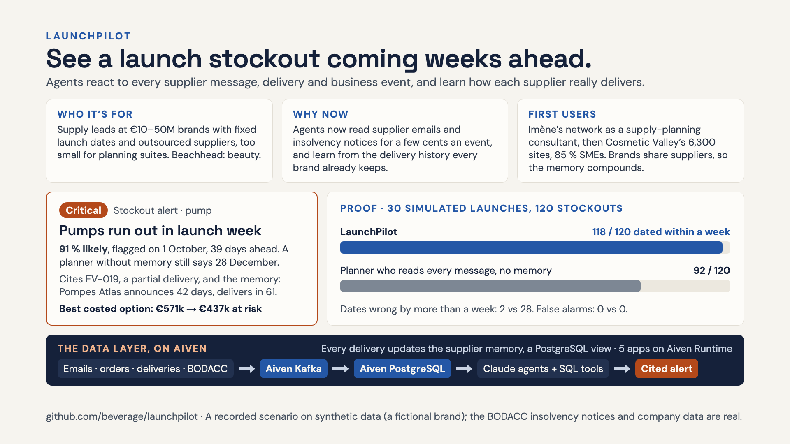

**Speaker notes**

> Top line: LaunchPilot sees a launch stockout coming weeks ahead, because its agents react to every supplier message, delivery and business event, and learn how each supplier really delivers.
> Who: supply leads at 10 to 50 million euro brands with fixed launch dates and outsourced suppliers, too small for the planning suites. We start in beauty.
> Why now: agents can read supplier emails and official insolvency notices for a few cents an event, and the delivery history that teaches them already sits in every brand’s spreadsheet or ERP.
> The product: the pump alert. On 1 October LaunchPilot says the pumps run out in launch week, 91 % likely, while a planner without memory still says 28 December. It cites the partial delivery and the supplier memory: Pompes Atlas announces 42 days and really delivers in 61. The best costed option, filling the gift set first, cuts revenue at risk from 571k to 437k euros.
> Proof: over 30 simulated launches, LaunchPilot dates 118 of 120 stockouts within a week, against 92 for a planner who reads every message but has no memory; 2 dates wrong by more than a week against 28. No false alarms on either side. The baseline is honest: nobody at an SMB reads every message.
> Data layer: live streams (supplier emails, retailer order books, deliveries, BODACC notices) through Aiven Kafka into Aiven PostgreSQL; the agents work through SQL-backed tools; every delivery updates the supplier-memory view; five apps on Aiven Runtime.
> First users: Imène’s network as a supply-planning consultant, then the Cosmetic Valley cluster. Brands share packaging suppliers, so the memory gets better with every customer.
> Say what is recorded (the scenario, synthetic data) and what is real (the agents, the streams, the BODACC notices).
