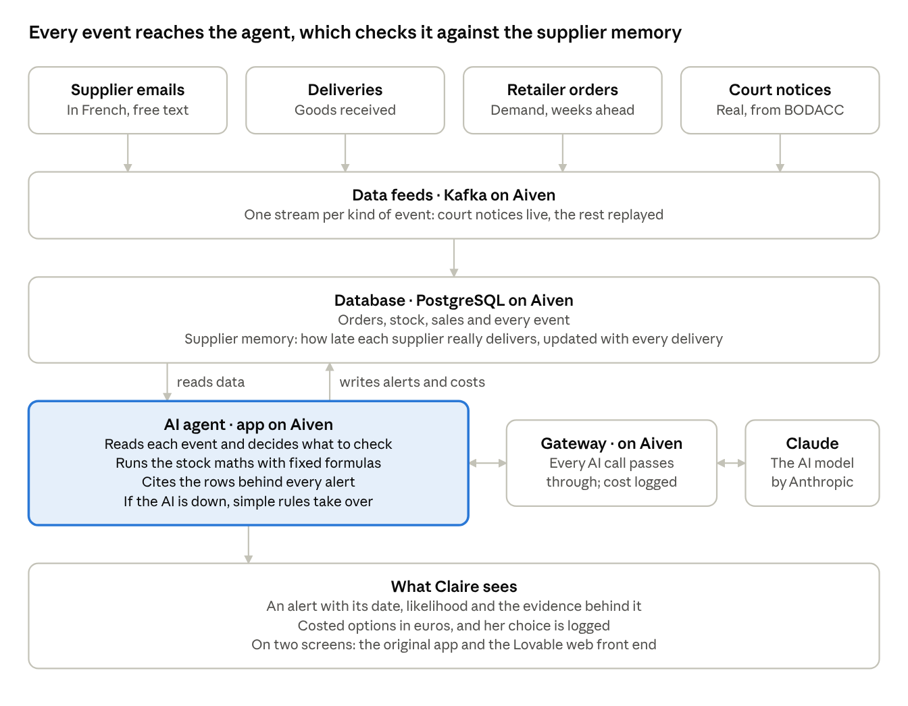

# LaunchPilot postmortem: how we built it

22 October 2026 · Alex Beverage

## In short

LaunchPilot finished in the top 8 of the final, but not in the top 3. It warns a small brand's supply manager, weeks ahead, that a product launch is about to run out of a part. The build side took one day, starting from Imène's prototype, with Alex steering several AI coding sessions that worked side by side.

Three things carried the day:

- **We chose a fair test over a flattering one.** Our first comparison was against a spreadsheet nobody would defend. We swapped it for an attentive human planner, and still won 118 to 92 out of 120 predictions.
- **One rulebook let many workers run at once.** Each AI session owned its own folders, wrote every decision in one shared log, and claimed tasks on one shared board. Nobody overwrote anybody.
- **Nothing on stage could break the demo.** If the AI, the database or the data feeds go down, the app falls back to rules and recorded data, and says so on screen.

## Everything from the day

Every document, deck and repository from the build, in one table.

| What | What's in it |
| --- | --- |
| [Pitch deck](pitch-deck.md) | The 10-slide deck for the final, with the technical slide and, as an appendix, the one-page slide we submitted. Each slide with its speaker notes. |
| [Design in plain words](design-in-plain-words.md) and [technical design](design-technical.md) | The non-technical design, and the technical one: architecture, data model, agents and the forecasting maths. Written around 13:00, so some numbers predate the afternoon's fixes; this postmortem has the final ones. |
| [Three-minute script](../docs/SCRIPT.md) | The talk track for the pitch and the answers we prepared for judges' questions. |
| [Example prompt](example-prompt.md) | One real call to Claude, word for word. |
| [How I piloted Claude Code](piloting-claude-code.md) | Alex's account of the method: the preparation, how the sessions ran, and where we tripped up. |
| [Code: beverage/launchpilot](https://github.com/beverage/launchpilot) | Public: the app, agents, data generator, proof script, decision log and task board. |
| [Web front end: beverage/launchpilot-web](https://github.com/beverage/launchpilot-web) | Public: the web app designed in Lovable. |
| [Submitted slide](../docs/pitch-slide.png) | The one-page slide from the submission form, with the final numbers. |

## The challenge and the idea

The organisers asked for a working product where AI agents depend on data to help a specific user, deployed on their sponsor Aiven's hosting platform. Our reading: if the agent still works without the data, it won't score.

Imène brought the user and the problem. Claire is the supply manager at an independent French cosmetics brand of 10 to 50 M€, launching a Christmas gift box. Her suppliers promise delivery times they don't keep, and the planning tools that would catch this are sold to much bigger companies.

LaunchPilot does two things a spreadsheet can't:

- **It remembers how late each supplier really is.** Every past delivery teaches it the gap between the promised and the actual date, and it plans with the real number.
- **It reads the outside world as it happens.** Supplier emails in French, deliveries arriving at the warehouse, retailer orders and real insolvency notices from the French official gazette (BODACC) each trigger the agent to check whether the launch is still safe.

The brand in the demo, Maison Aurore, is fictional and its data is made up. The insolvency notices and company records are real, and the app labels which is which.

## What we shipped

The submission carries a three-minute demo video, one pitch slide and the public code. The demo tells one story in eight beats:

1. **The stake.** Claire's gift set launches on 2 November. Her spreadsheet says the pumps hold until December.
2. **Raw numbers in.** In September, retailers' order books arrive. LaunchPilot spots 40% more demand for one serum than forecast and puts the pumps on watch, 46 days ahead.
3. **The catch.** On 1 October a French email says the pump supplier will deliver only 12,000 of 20,000. Because LaunchPilot remembers this supplier has been late every time, it says the pumps run out the week after launch, at 91% likelihood. A careful planner without that memory still says 28 December.
4. **The decision.** Doing nothing puts 571 k€ of sales at risk. A rush order would arrive too late, and LaunchPilot says so. The best move is to send the remaining pumps to the gift set first: 437 k€ at risk.
5. **The memory learns.** A late pump delivery lands during the demo, and the supplier's real lead time visibly moves from 62 to 63 days.
6. **Real data.** A real court notice puts a cardboard-box maker into receivership. Mapped, with a label, to our fictional gift-box supplier, it shows about 1.07 M€ more at risk if that supplier's open order doesn't arrive.
7. **Proof.** Across 30 randomly generated test worlds, LaunchPilot dates 118 of 120 stockouts within a week; the careful planner dates 92. Cost and speed per event are on screen.
8. **Live and recorded.** We say out loud what runs live (the AI agents and the court notices) and what we built ourselves and replay (the brand, its history, its emails and deliveries).

There are two ways to see it: the original app Imène's kit came with, and a new web front end the team designed in Lovable. Both read the same live database.

## How the day ran

The app was live on Aiven by 10:47, under two hours after kickoff; everything after that was making it smarter and more honest. Over the day the team repo took 132 saved changes and the web front end 72, 55 of those made through Lovable.

| Time | What happened |
| --- | --- |
| Day before | Alex set up the Aiven accounts, a deploy script and an empty starter app. No product code, by the rules. |
| Overnight | Imène uploaded her LaunchPilot prototype and brief. |
| 09:15 | Work on the web front end starts in Lovable. |
| 10:33 | One shared public code repository; the work is split by folder and the decision log opens. |
| 10:41 | Imène's prototype is moved in, with its history, and runs against our Aiven database. |
| 10:47 | First version live on Aiven's hosting. Eleven minutes later the AI agent runs live on it. |
| 10:48 | The live data pipeline and the court-notice watch go online. |
| 11:08 | The fair comparison replaces the strawman one (see What went well). |
| 11:34 | Every AI call now goes through our own gateway on Aiven, which logs what each one costs. |
| 11:41 | Screens and agent switch to English; supplier emails and court notices stay in French. |
| 12:16 | The agent reads supplier emails live, and each delivery teaches the supplier memory. |
| 12:30 | Three data feeds flow end to end through Kafka: real court notices, plus replayed emails and deliveries. |
| 12:39 | A real court notice is mapped, with a label, to our fictional gift-box supplier. |
| 13:28 | Proof chart and cost-per-event panel go live. |
| 13:40 | The submission form arrives: the video is required, and the slide is all a finalist shows on stage. |
| 14:13 | The court-notice alert now puts a number on the risk: about 1.07 M€. |
| 14:27 | Feature freeze pushed back to add more catches to the demo. |
| 14:30 | A delivery-date fix changes the headline numbers (see What was hard). |
| 14:39 | Retailer order books replace a pre-labelled demand spike. |
| 15:03 | A third catch, on factory capacity, is dropped from the demo. |
| 15:08 | Last change: the submission text is final. |

## How it fits together

Outside events flow in, an AI agent checks each one against what the brand knows, and Claire gets an alert with its evidence attached.

Read it top to bottom. The agent never invents a number: the maths are fixed formulas, and the agent picks which to run and explains the answer. Every delivery that arrives updates the supplier memory, so the next forecast already knows.

## What the AI actually sees

For each event, Claude gets three things: a fixed page of instructions, the event itself, and the list of alerts already open. It gets none of the brand's data up front. It asks for what it needs through ten tools, and our code does the maths.

Take the pump email of 1 October. Claude read the French, then:

1. Recorded it as a partial delivery: 12,000 of the 20,000 pumps on order.
2. Ran the stock projection, which drew on the supplier memory: promised 42 days, actually 60.9 on average over 14 deliveries.
3. Raised a high alert: the pumps run out the week of 9 November, 91% likely, citing five rows of evidence.

That took four round trips with Claude, about 21,000 tokens and 14 seconds. The full prompt, word for word: [Example prompt](example-prompt.md).

## How we worked

Alex ran up to four Claude coding sessions at once, each like a teammate with its own desk. Alex set direction, made the calls and checked the results; the sessions wrote and tested the code.

| Session | What it owned | For example |
| --- | --- | --- |
| Kickoff | The app itself: the agents, the forecasting maths, the proof | The fair comparison, the live email reading, the cost panel |
| Prep | Data coming in and hosting on Aiven | The live data pipeline, the court-notice watch, the company records, the AI gateway |
| Test data | Making the made-up brand believable | Rebalancing purchase history, the order books, the pitch script |
| Front end | The bridge between the Lovable design and the live data | The web API, live data in the Lovable preview |

Three simple rules kept them from tripping over each other:

- **Separate folders.** Each session only touched its own part of the code, so two never edited the same file at once.
- **One task board.** A single table listed every task with an owner and a status (to do, doing, done, cut). Anyone, human or AI, claimed a task there before starting it.
- **One decision log.** Every call went in as one line: the time, the decision, why, and who. We logged 50 that day, about half by Alex and a third by the AI sessions. Lines are never edited; a reversal is a new line. When a session wondered why something was the way it was, the answer was written down.

One more rule: the live app had to work after every change. Risky work happened on the side and joined the main version only once the full demo still ran. The design side moved in parallel in Lovable, and changes there flowed into the same live app.

## What went well

- **Live early.** The app ran on Aiven before 11:00. From then on every hour improved something that already worked, rather than racing to get anything on screen.
- **An honest proof.** The prototype compared LaunchPilot with a spreadsheet nobody reads. Tested fairly, a planner who reads every email scored better than LaunchPilot did. By 11:08 we had rebuilt the test against that careful planner and made the supplier memory plan with each supplier's typical delay and a likelihood. It now wins fairly, 118 against 92 out of 120.
- **Integrity under time pressure.** Twice we gave up a better-looking result. A date fix at 14:30 raised the best option's risk from 194 k€ to 437 k€, and we kept the honest number. At 15:03 we dropped a capacity catch because we had set the numbers to make it happen.
- **Real public data, handled with care.** The court notices are real, but we show no names of people, never say anything about the real company's delivery times, and label the link to our fictional supplier everywhere.
- **Sponsor fit that does real work.** Five apps run on Aiven's hosting, data lives in its database, data feeds flow through its streaming service, and every AI call passes through a gateway on Aiven that logs its cost.
- **Design and code in parallel.** Lovable showed live data from 13:39, so design choices were made against the real numbers, not placeholders.

## What was hard and what broke

The two biggest headaches were a shared database anyone can reset, and headline numbers that changed twice in the afternoon.

| Problem | What it did | What we did |
| --- | --- | --- |
| One shared database for everyone | A newly started web API reloaded old data and reset the demo twice around lunch. Any visitor who presses Reset changes what everyone else sees. | Only the main app may now set up the data; we check the live app by reading, never by pressing demo buttons. |
| Moving numbers | The fair test set the headline at 112 vs 97 at 11:05; the date fix moved it to 118 vs 92 at 14:30, and the best option from 194 k€ to 437 k€. | Every change was logged, then the README, script, slide and form text were updated to match. |
| Made-up data that didn't add up | The brand's history showed 400,000 pumps received against 117,000 used. A judge who did the sum would stop believing the story. | Rebalanced the purchase history without moving any proof number, with Imène's review of the four calls only she could make. |
| A silent bug | The real court-notice alert was dropped because the app thought it duplicated the pump alert on the same week. | Caught at 13:08 by checking the deployed app step by step; the two kinds of alert now coexist. |
| Hosting quirks | A redeploy reported success but built nothing; settings refused line breaks, which security certificates contain. | Redeploy by switching branch; certificates stored in a one-line encoded form. Both are written down for next time. |
| Sponsor's AI gateway not approved in time | We could not route AI calls through Aiven's own gateway. | Ran our own gateway on Aiven instead, which also gave us the cost of every call. |
| Free-plan limits | Aiven's free streaming plan allows only five feeds. | Cut the public-holiday feed; the engine already knew the holidays. |
| Late news on the form | At 13:40 we learned the video was required and the single slide is all a finalist shows on stage. | Wrote the shot list, script and slide in the next hour, alongside the build. |

## What we would do differently

Most of our late stress came from things we learned after lunch that we could have learned at breakfast.

- **Read the submission form at kickoff.** Knowing at 09:00 that the video is required and the slide is all a finalist shows would have shaped the morning.
- **Freeze earlier, and keep it.** We moved the feature freeze past 15:00 to add catches, then dropped one of them. A firm freeze leaves the last hour for the video and rehearsal.
- **Pick one front end early.** Two screens on one engine meant the web side kept catching up with engine changes, and which one the demo shows stayed an open question all day.
- **Give the demo its own database.** A copy for the video and one for judges, so nobody's Reset spoils anyone else's run.
- **Check the calendar first.** The working-day fix that moved our numbers at 14:30 was a morning-sized question.
- **Ask sponsors for access the day before.** The AI gateway approval never came in time.
- **Bring a real voice.** A one-line quote from a real supply manager about late suppliers stayed on our open list all day.

## Glossary

| Term | In plain words |
| --- | --- |
| Agent | An AI that reads an event, decides what to check, runs the calculations and explains the result. Ours is Claude, by Anthropic. |
| Aiven | The hackathon's sponsor. It hosts our apps and runs our database and data feeds. |
| BODACC | France's official gazette of company events, including insolvencies. Public and free. |
| Catch | A moment in the demo where LaunchPilot spots a problem a planner would miss. |
| Decision log | One shared file where every call is written as one line: time, decision, why, who. |
| Fallback (rules mode) | Simple fixed rules the app uses when the AI is unavailable, so the demo never stops. |
| Gateway | A checkpoint every AI call passes through. Ours records the cost of each call. |
| Kafka | A service that carries a stream of events, like a conveyor belt, from where they happen to our database. |
| Lead time | How long a supplier takes from order to delivery. The promised one and the real one often differ. |
| Lovable | The AI design tool the team used to build the web front end. |
| Repository (repo) | The shared folder that holds the code and its full history of changes. Ours is public. |
| Supplier memory | LaunchPilot's record of how late each supplier really delivers, updated with every delivery. |
| Synthetic data | Data we made up to look realistic. Maison Aurore and its history are synthetic. |
